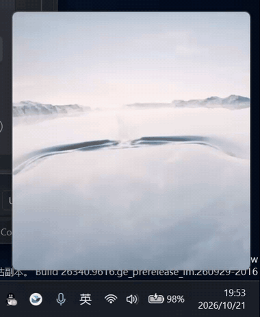
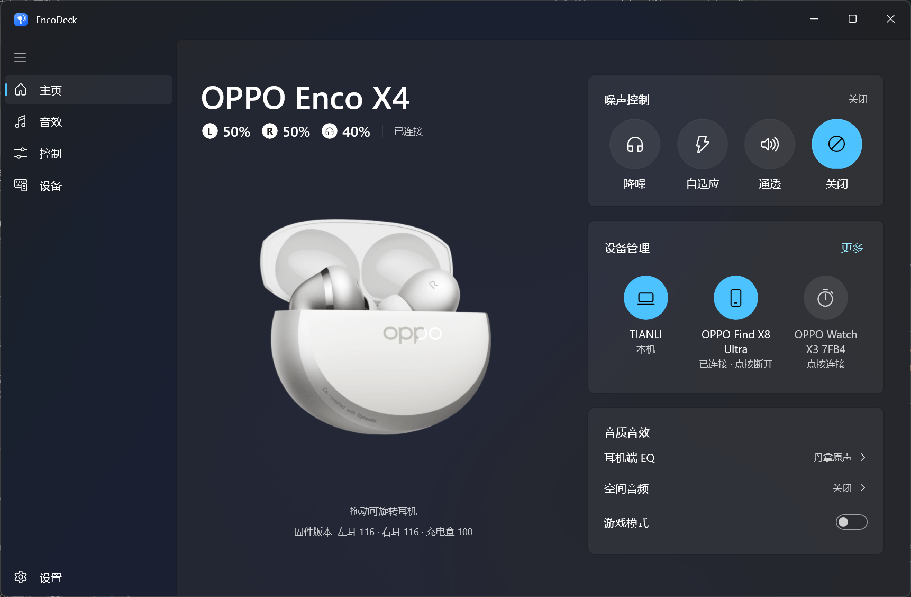
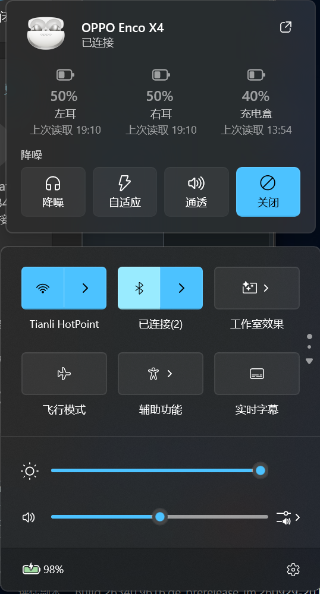

<p align="center"></p>

# EncoDeck

**A native Windows control center for OPPO earbuds** — check battery, switch noise control and adjust
sound from your PC instead of reaching for your phone.

> ⚠️ **Unofficial project.** EncoDeck is community-built open-source software. It is not affiliated
> with, endorsed by or supported by OPPO, OnePlus or realme. Product names are used only to describe
> compatibility.

[简体中文](README.md) · [Compatibility](docs/COMPATIBILITY.md) · [Protocol findings](docs/PROTOCOL_FINDINGS.md) · [Implementation status](docs/IMPLEMENTATION_STATUS.md)

<p align="center">
  
</p>

| Home | Tray quick panel (above Windows Quick Settings) |
|---|---|
|  |  |

## Features

- **Lives in the notification area**: left click opens a quick panel (battery + noise control), right
  click opens a native menu; near-zero CPU while idle.
- **Connection popup** near the taskbar when the earbuds connect, with the model's lid-open animation
  and battery levels (Composition animations, pauses on hover, suppressed while a fullscreen game is
  running). Only the video is decoded: it never opens an audio stream, never shows up in the system
  media controls and cannot be paused by an earbud tap or a media key.
- **3D device model** on the home page, as in HeyMelody: pre-rendered turntables rotate left/right;
  `.vfxms` 3D models (e.g. Enco X3, Free4) are rendered live — drag in any direction, zoom with the
  wheel, double-click to reset.
- **Battery**: left / right / case with charging state and live updates; the case shows "last read"
  when it is not reporting.
- **Noise control**: noise cancelling (high / moderate / low / auto), adaptive, transparency, off —
  stays in sync when you change it on the earbuds or your phone.
- **Global hotkeys**: switch between noise cancelling and transparency, step through the modes or
  jump to one from any app (fullscreen games included); bind them in Settings › Hotkeys.
- **Real device communication**: every change is sent over Bluetooth RFCOMM, acknowledged and read
  back from the earbuds; failures roll back. EncoDeck never shows simulated state.
- **Fluent Design**: WinUI 3, Mica / Acrylic, light & dark, system accent colour, Chinese / English.

## Tested hardware

| Model | Firmware | Status |
|---|---|---|
| OPPO Enco X4 | L 116 / R 116 / case 100 | Battery, wear state, all noise-control modes and firmware info verified; see the [compatibility table](docs/COMPATIBILITY.md) |

Other OPPO / OnePlus earbuds are detected as "unverified model" and shown read-only; EncoDeck sends no
settings to them.

## Known limitations

- Pair and connect the earbuds in Windows Bluetooth settings first; EncoDeck never pages a
  disconnected device.
- Not implemented yet: BLE lid-open popup, custom EQ editing, touch-control remapping, firmware
  updates (OTA is out of scope for v1).
- Some features are "experimental" and must be enabled in **Settings → Advanced**.
- The self-contained build is large (≈50 MB installer, ≈180 MB installed) because it bundles the .NET
  and Windows App SDK runtimes, so nothing else needs to be installed.

## Download & install

### Microsoft Store (recommended)

<a href="https://apps.microsoft.com/detail/9PN6D8G1K9WZ?mode=direct"></a>

[Open in the Microsoft Store](https://apps.microsoft.com/detail/9PN6D8G1K9WZ) · x64 and ARM64, updated automatically by the Store;
Settings › Updates can also check for and install Store updates. Start with Windows uses a startup task you can manage
under Task Manager › Startup apps.

### Installer

Run `EncoDeck-Setup-<version>-win-x64.exe` from [Releases](https://github.com/TIANLI0/EncoDeck/releases).
It installs per user into `%LOCALAPPDATA%\Programs\EncoDeck` without administrator rights.
**Installing a newer version over an existing one upgrades it in place**, keeping settings, cache and
custom resources. Uninstalling asks whether to delete user data (`%LOCALAPPDATA%\EncoDeck`).

**In-app updates:** Settings › Updates checks GitHub Releases for a newer version (by default once a day,
downloading it in the background; can be turned off, and preview versions are opt-in). The installer's
size and SHA-256 are verified, nothing is installed until you click "Restart and update now", and
EncoDeck starts again after the update.

Requirements: Windows 10 19041 or later (Windows 11 recommended); the installer is x64, the Store version supports x64 and ARM64.

## Building

```powershell
git clone https://github.com/TIANLI0/EncoDeck
cd EncoDeck
dotnet test tests/EncoDeck.Tests
pwsh build/build-installer.ps1      # installer in artifacts\installer
```

Requires the .NET SDK 10.0.100+; Visual Studio is not needed. See [DEVELOPMENT.md](docs/DEVELOPMENT.md).

## Diagnostics

`EncoDeck.Probe` inspects earbuds without the UI (devices, SDP, read-only queries, event watch) and
redacts Bluetooth addresses by default. See [TESTING.md](docs/TESTING.md).

## Contributing

Compatibility reports, protocol findings and code are welcome — please read [CONTRIBUTING.md](CONTRIBUTING.md).

## Acknowledgements

Protocol research by [OppoPodsWindows](https://github.com/3295074384/OppoPodsWindows),
[OppoPodsManager](https://github.com/Zhaoyi-ya/OppoPodsManager) and
[OppoPods](https://github.com/Leaf-lsgtky/OppoPods); tray icon by
[H.NotifyIcon](https://github.com/HavenDV/H.NotifyIcon). See [THIRD_PARTY_NOTICES.md](THIRD_PARTY_NOTICES.md).

## License

[GPL-3.0-only](LICENSE).
